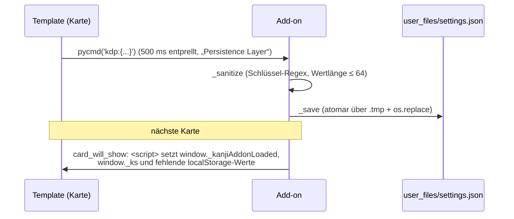

# Addon – Kanji Draw Persistence

Ein Anki-Desktop-Add-on (AnkiWeb-ID `905251277`, ab Anki 23.10). Es behält die Karteneinstellungen über einen Neustart hinweg.

Der Hintergrund: Anki Desktop nutzt ein flüchtiges `QWebEngineProfile`. Cookies und `localStorage` sind nach jedem Neustart leer. Die Templates funktionieren auch ohne das Add-on, setzen die Einstellungen dann aber jedes Mal zurück und zeigen den Hinweis `#addon-hint`.

## Dateien

| Datei | Inhalt |
|---|---|
| [manifest.json](manifest.json) | Paketname, Version, AnkiWeb-ID, Mindestversion |
| [__init__.py](__init__.py) | gesamte Logik (139 Zeilen) |

## Ablauf

## __init__.py

| Zeilen | Name | Aufgabe |
|---|---|---|
| 1–29 | Kopf | Beschreibung, Importe, Pfad `user_files/settings.json` |
| 30–37 | Konstanten | `_MARKER_FIELD = "SVGPfade"` (erkennt KanjiDraw-Notizen), `_MAX_MESSAGE_LEN`, `_KEY_RE`, `_MAX_VALUE_LEN` |
| 40–50 | `_sanitize` | nur `kanji*`-, `c1_`/`c2_`/`c2f_kanji*`-Schlüssel mit kurzen String-Werten |
| 53–69 | `_load` | Datei lesen, im Speicher cachen |
| 72–88 | `_save` | atomar schreiben, Cache aktualisieren |
| 91–104 | `_on_js_message` | Hook `webview_did_receive_js_message` für `kdp:` |
| 107–112 | `_is_kanji_draw_card` | Notiztyp hat Feld `SVGPfade` |
| 115–135 | `_on_card_will_show` | Hook `card_will_show`: Einstellungen vor die Template-Skripte setzen (`</` wird als `<\/` maskiert) |
| 138–139 | Registrierung | Hooks anhängen |

Das Gegenstück in den Templates heißt „Persistence Layer [SHARED]“ (`safeGetItem`, `safeSetItem`, `_fc`), siehe [../Templates/README.md](../Templates/README.md#einstellungen-und-speicher).

## Code-Review: Stand

- **Sicherheit:** Schlüssel und Werte werden validiert, die Nachrichtengröße ist begrenzt, und die Injektion kann den `<script>`-Block nicht vorzeitig schließen. Keine Auffälligkeiten.
- **Keine Probleme mit Performance, Dead Code oder Redundanz.**
- `__pycache__/` steht in der `.gitignore` im Hauptordner.
