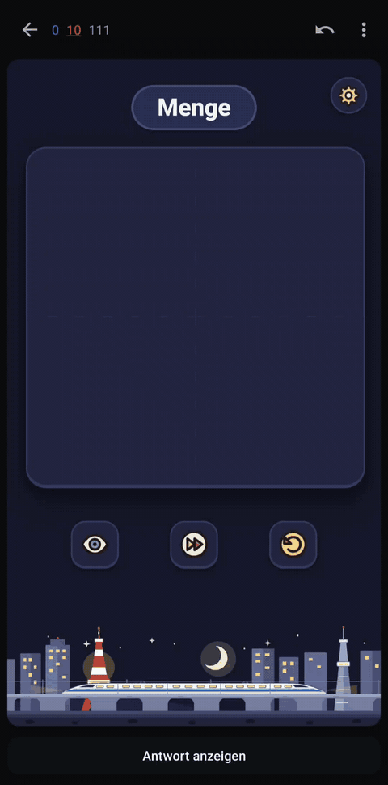
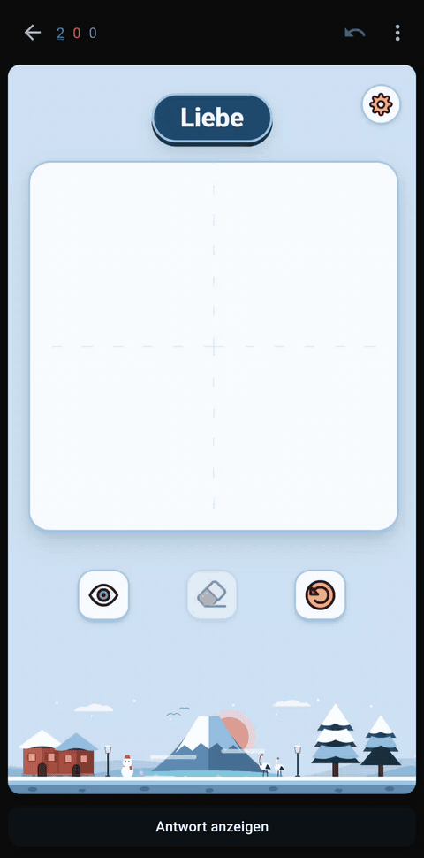
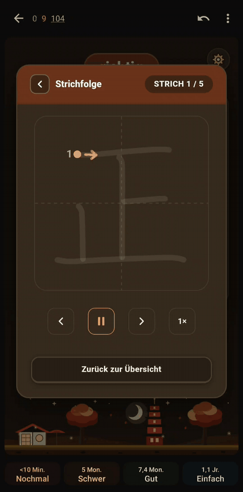
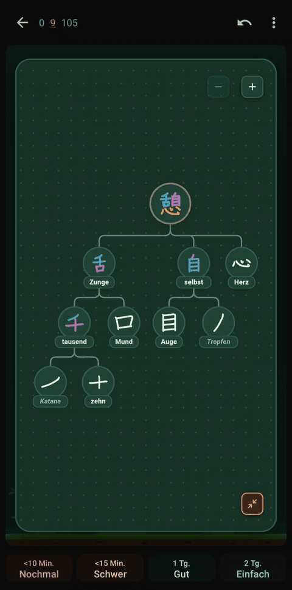
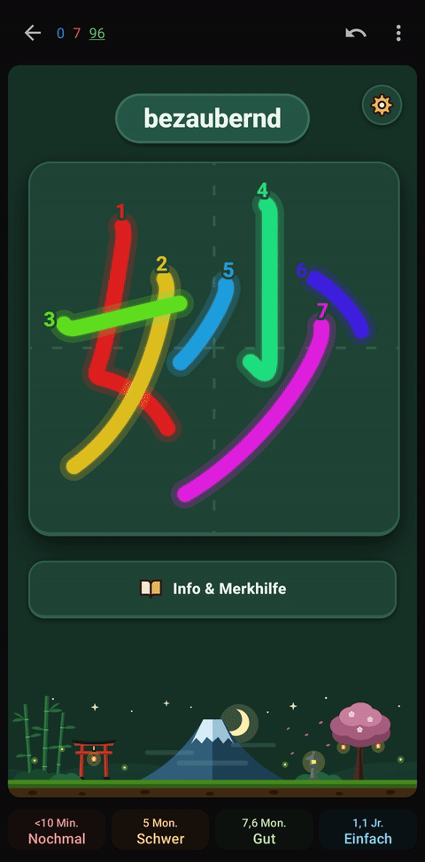
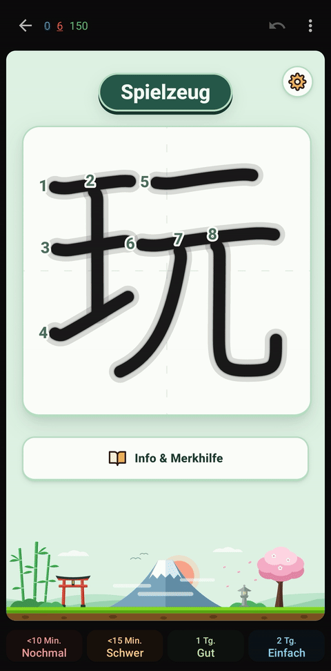

# Kanji Draw – Anki Note Template

Interaktives Anki-Template zum Erlernen der japanischen Kanji-Schriftzeichen — mit **echter Strich-Erkennung**, deutschen Eselsbrücken und vollständiger Plattform-Kompatibilität.


---

## Vorschau

<table align="center">
  <tr>
    <td align="center"><br><sub>✍️ Geführter Modus</sub></td>
    <td align="center"><br><sub>🖊️ Freihand-Modus</sub></td>
    <td align="center"><br><sub>🔢 Strichfolge</sub></td>
  </tr>
  <tr>
    <td align="center"><br><sub>🌳 Komponentenbaum</sub></td>
    <td align="center"><br><sub>🖼️ Galerie</sub></td>
    <td align="center"><br><sub>🏞️ Landschaften</sub></td>
  </tr>
</table>

---

## Inhaltsverzeichnis

- [Überblick](#überblick)
- [Kartentypen](#kartentypen)
- [Zeichenmodi](#zeichenmodi)
- [Bewertungsalgorithmus](#bewertungsalgorithmus)
- [Einstellungen](#einstellungen)
- [Klang & Musik](#klang--musik)
- [Info-Modal](#info-modal)
- [Plattform-Kompatibilität](#plattform-kompatibilität)
- [Notiztyp-Felder](#notiztyp-felder)
- [Installation](#installation)
- [Add-on: Kanji Draw Persistence](#add-on-kanji-draw-persistence)
- [Dateistruktur](#dateistruktur)
- [Technische Details](#technische-details)
- [Datenquellen & Attribution](#datenquellen--attribution)
- [Lizenz](#lizenz)

---

## Überblick

Kanji Draw ist ein vollständig selbst enthaltenes Anki-Template — keine Installation außer den Vorlagen, keine externen Dienste, vollständig offline-fähig. Es erzeugt **zwei Kartentypen** aus einem einzigen Notiztyp und bietet:

- **Echte Strich-Erkennung** auf Basis mathematischer Kurvenähnlichkeit (diskrete Fréchet-Distanz)
- **Zwei Lernmodi**: Strich für Strich geführt oder freies Zeichnen des gesamten Kanji
- **Anpassbares Erscheinungsbild**: 4 Strichstile, 6 Akzentfarben, 9 Japan-Themes mit eigener Landschaft, Dark/Light Mode
- **Klang & Musik**: prozedural erzeugte japanische Musik, Naturklänge, Strichgeräusche und Effekte — ohne Audiodateien, standardmäßig aus
- **Umfassendes Info-Modal**: Komponentenbaum, Eselsbrücke, Strichfolge-Player, häufige Schreibfehler, Wortbeispiele, Lesungen, externe Links
- **Vollständige Plattformunterstützung**: Desktop, Android (inkl. S-Pen), iOS (inkl. Apple Pencil), Web

---

## Kartentypen

| | **Card 1 – Aktiv (Schreiben)** | **Card 2 – Passiv (Erkennen)** |
|---|---|---|
| **Vorderseite** | Deutsche Bedeutung · Zeichenfläche | Fertiges Kanji (optional nummeriert oder nach Strichfolge eingefärbt) |
| **Rückseite** | Bewertung jedes Strichs · Info-Modal | Schlüsselwort · Info-Modal |
| **Lernziel** | Kanji aus der Bedeutung abrufen und schreiben | Kanji sehen und die Bedeutung abrufen |

Die Kartentypen können unabhängig voneinander konfiguriert werden. Card 1 bietet den vollen Einstellungsumfang (Zeichenmodus, Genauigkeit usw.); Card 2 beschränkt sich auf Darstellungsoptionen für das angezeigte Kanji (Strich-Nummern, Strich-Darstellung) sowie die gemeinsamen Erscheinungsbild-Einstellungen.

---

## Zeichenmodi

### ✍️ Geführter Modus

Der nächste Strich wird hervorgehoben — sobald er korrekt gezeichnet wurde, erscheint automatisch der folgende. Fehlerhafte Striche werden sofort farblich markiert.

- Nach **3 Fehlversuchen** erscheint automatisch ein Zeichenhinweis (abschaltbar)
- Überspringen-Funktion für den aktuellen Strich
- Optionale Abschluss-Animation (Glow + Sparkle)

### 🖊️ Freihand-Modus

Das gesamte Kanji wird in einem Zug frei gezeichnet — ohne Reihenfolgevorgabe. Nach dem Aufdecken der Rückseite wird jeder Strich automatisch dem passenden Referenzstrich zugeordnet und bewertet.

- **Ungarischer Algorithmus** (O(n³)) für optimale Strich-Zuordnung
- Jeder zugeordnete Strich wird einzeln bewertet
- Fehlende, überzählige und falsch gezogene Striche werden gesondert gekennzeichnet
- Rückgängig-Funktion für den letzten Strich

---

## Bewertungsalgorithmus

Jeder Strich wird auf Basis von vier Komponenten bewertet:

| Komponente | Gewichtung | Beschreibung |
|---|:---:|---|
| **Form** (Fréchet-Distanz) | 40 % | Globale Kurvenähnlichkeit zwischen Nutzerstrich und Referenzpfad |
| **Durchschnittlicher Punktabstand** | 25 % | Mittlere euklidische Abweichung der Abtastpunkte |
| **Startpunkt-Toleranz** | 17,5 % | Abweichung des Strichanfangs vom Referenzstartpunkt |
| **Endpunkt-Toleranz** | 17,5 % | Abweichung des Strichendes vom Referenzendpunkt |

Vor der Bewertung durchläuft jeder Strich drei **Hard Gates**:
- **Längenverhältnis**: 40–250 % der Referenzlänge (verhindert zu kurze oder zu lange Striche)
- **Richtungsprüfung**: 4-Sektor-Winkelvergleich (erkennt gespiegelte oder umgekehrte Striche)
- **Deckel-Multiplikator**: 1,4–1,6× (verhindert Dominanz einzelner Komponenten)

Alle Striche werden auf **64 Abtastpunkte** normalisiert (Catmull-Rom-Resampling). Die Fréchet-Distanz wird per iterativem Dynamic Programming (O(n²)) berechnet.

### Strich-Genauigkeit

Die drei Stufen skalieren alle Schwellenwerte gleichmäßig:

| Stufe | Multiplikator | Effekt |
|---|:---:|---|
| **Locker** | × 1,35 | Großzügigere Toleranzen — gut für Anfänger |
| **Normal** | × 1,0 | Ausgewogene Standardeinstellung |
| **Streng** | × 0,7 | Engere Toleranzen — für geübte Lernende |

### Fehler-Farbcodierung (Rückseite)

| Fehler | Farbe | Bedeutung |
|---|---|---|
| 0 | 🟢 Grün | Strich korrekt gezeichnet |
| 1 | 🟠 Orange | Leichte Abweichung |
| 2 | 🟧 Dunkelorange | Merkliche Abweichung |
| 3+ | 🔴 Rot | Strich falsch oder nicht erkannt |

---

## Einstellungen

Alle Optionen sind über das **⚙️ Zahnrad-Menü** erreichbar. Einstellungen werden pro Kartentyp (Card 1 / Card 2) unabhängig gespeichert; Erscheinungsbild und Klang gelten für beide. Dauerhafte Standardwerte lassen sich oben in `Templates/Styling.css` (Block „DEINE DAUERHAFTEN EINSTELLUNGEN“) eintragen.

### Zeichnen & Bewertung

| Einstellung | Card 1 | Card 2 | Optionen |
|---|:---:|:---:|---|
| **Zeichenmodus** | ✓ | — | Geführt · Frei |
| **Strich-Genauigkeit** | ✓ | — | Locker · Normal · Streng |
| **Echtzeit-Prüfung** | ✓ | — | An · Aus |
| **Zeichen-Hilfe** | ✓ | — | An · Aus |
| **Abschluss-Animation** | ✓ | — | An · Aus |
| **Startpunkt-Hilfe** | ✓ | — | An · Aus (nur Geführt) |
| **Startpunkt-Hilfe: Zeitpunkt** | ✓ | — | Sofort · Nach 4 s ohne Zeichnen |

### Rückseiten-Darstellung

| Einstellung | Card 1 | Card 2 | Optionen |
|---|:---:|:---:|---|
| **Farb-Bewertung** | ✓ | — | An · Aus |
| **Strich-Nummern** | ✓ | ✓ | An · Aus |
| **Strichansicht** | ✓ | — | Handschrift beibehalten · SVG-Pfade einblenden |
| **Strich-Darstellung** | — | ✓ | Standard · Farbig (Regenbogen-Strichreihenfolge) |

Card 2 hat zusätzlich eine eigene Seite **Vorderseite** mit Strich-Nummern und Strich-Darstellung für das angezeigte Kanji.

### Hilfslinien-Raster

| Einstellung | Optionen |
|---|---|
| **Muster** | Kein · Kreuz (Mittellinien) · Voll (+ Diagonalen) |
| **Linienstil** | Gepunktet · Gestrichelt · Durchgehend |
| **Dicke** | Dünn · Mittel · Dick |
| **Sichtbarkeit** | Hell (30 %) · Mittel (60 %) · Dunkel (100 %) |

### Erscheinungsbild

| Einstellung | Optionen |
|---|---|
| **Modus** | System (automatisch) · Hell · Dunkel |
| **Akzentfarbe** | 🟢 Grün · 🔵 Blau · 🟣 Lila · 🟠 Orange · 🔴 Rot · 🩵 Türkis |
| **Japan-Theme** (Landschaft & Farben) | Fuji · Kinkaku · Onsen · Momiji · Sakura · Bambus · Hokkaidō · Tokyo · Okinawa · Zufall (jede Karte neu) |
| **Strichstil** | Standard · Gelstift · Tusche · Neon |
| **Strichstärke** | Dünn · Normal · Dick |
| **Strichfarbe** | Schwarz · Tintenblau · Violett · Braun · Türkis · Schiefer |
| **Schriftgröße** | Klein · Normal · Groß |

#### Strichstile im Detail

| Stil | Aussehen |
|---|---|
| **Standard** | Klarer, gleichmäßiger Strich |
| **Gelstift** | Weicher Wet-Ink-Look mit leuchtendem Halo-Effekt |
| **Tusche** | Variierender Pinselstrich mit dynamischer Breite |
| **Neon** | Leuchtender Glow-Effekt (SVG-Doppelfilter, GPU-optimiert) |

### Danke & Feedback

Das kleine ❤️ oben rechts in den Einstellungen öffnet eine Dankesseite mit Links zur Bewertung auf AnkiWeb, zu GitHub-Issues für Fehler und Ideen sowie den Quellenangaben.

---

## Klang & Musik

Eine eigene Klang-Engine (Web Audio API) erzeugt alles zur Laufzeit — keine Audiodateien, keine Netzwerkzugriffe. Standardmäßig ist der Klang **aus**.

- **Musik** aus gemeinfreien japanischen Liedern (z. B. Sakura Sakura, Kōjō no Tsuki, Tōryanse, Furusato), je Strophe anders arrangiert; die Musik läuft über Kartenwechsel weiter
- **Landschaft = Klangfarbe**: Jedes Japan-Theme hat eigene Instrumente, Raumklang und Naturgeräusche (Tag und Nacht)
- **Reaktion aufs Zeichnen**: Richtige Striche antworten im Takt, fertige Kanji lassen die Musik wachsen, Denkpausen lichten sie aus
- **Strichgeräusche** passend zum Strichstil und dezente **Effekt-Klänge** für Knöpfe, Baum, Furigana und Schreibfehler

| Einstellung | Optionen |
|---|---|
| **Gesamtlautstärke** | Aus · Leise · Mittel · Laut |
| **Musik** | Keine · Ambient · Zen · Klavier · Lo-Fi · Nur Natur |
| **Reaktion aufs Zeichnen** | Aus · Dezent · Stark |
| **Musik-Lautstärke** | Leise · Mittel · Laut |
| **Strichgeräusche** | Aus · An |
| **Effekt-Klänge** | Aus · An |

> Browser und WebViews erlauben Klang erst nach einer Berührung. Die Musik setzt deshalb mit dem ersten Tippen oder Strich ein.

---

## Info-Modal

Das Info-Modal (📖-Schaltfläche auf der Rückseite) zeigt alle verfügbaren Informationen zu einem Kanji auf einen Blick:

| Bereich | Inhalt |
|---|---|
| **Kopfzeile** | „Übersicht“ · laufende Nummer (`Nummer`) · deutsche Bedeutung |
| **Tags** | JLPT-Stufe · Häufigkeitsrang |
| **Komponentenbaum** | Zerlegung in Bausteine/Primitive; Antippen färbt die zugehörigen Striche, mit Zoom und Vollbild |
| **Strichfolge** | Animierter Player mit Schritt-für-Schritt-Steuerung |
| **Schreibfehler** | Typische Fehler (Reihenfolge, Richtung, Zug, Form) mit Vorschau am Kanji; nur wenn `Stolperfallen` befüllt ist |
| **Eselsbrücke** | Deutsche Merkhilfe mit farbig hervorgehobenen Bausteinen und optionalem visuellem Hinweis |
| **Wortbeispiele** | Anklickbare Beispielwörter mit ein-/ausblendbarer Furigana |
| **Lesungen** | ON- und KUN-Lesung mit farbigen Labels |
| **Externe Links** | [Jisho](https://jisho.org) · [Tatoeba](https://tatoeba.org) · [WaniKani](https://www.wanikani.com) · [Koohii](https://kanji.koohii.com) |

---

## Plattform-Kompatibilität

| Plattform | Status | Besonderheiten |
|---|:---:|---|
| **Anki Desktop** (23.10+, getestet bis 26.09) | ✅ | Maus + Pointer-Events; Add-on für Einstellungspersistenz empfohlen |
| **AnkiDroid** (2.25.3+ empfohlen) | ✅ | Touch + S-Pen; Cookie-Persistenz; Gesten-Hooks `userJs1/2/3`; alter und neuer Lernbildschirm |
| **AnkiMobile (iOS)** | ✅ | Touch + Apple Pencil; `position:fixed` Scroll-Lock; Safe-Area-Insets |
| **AnkiWeb** | ✅ | Vollständig browserbasiert; dynamische Viewport-Anpassung |

### Gesten-Hooks (AnkiDroid & AnkiMobile)

Folgende JavaScript-Funktionen können Geräte-Gesten zugewiesen werden:

| Funktion | Card 1 | Card 2 | Beschreibung |
|---|:---:|:---:|---|
| `userJs1` | ✓ | ✓ | Referenzstrich einblenden/ausblenden (C1) · Einstellungen (C2) |
| `userJs2` | ✓ | — | Zeichenfläche zurücksetzen |
| `userJs3` | ✓ | ✓ | Einstellungen öffnen |

**AnkiDroid:** *Einstellungen → Gesten → JavaScript-Funktion 1/2/3*  
**AnkiMobile:** *Einstellungen → Gesten → Eigene Aktion → JavaScript ausführen*

### Hinweise zu AnkiDroid

- Der **neue Lernbildschirm** (*Einstellungen → Neuer Lernbildschirm*) wird **dringend empfohlen**: Zeichenstriche decken dort die Rückseite nicht versehentlich auf, die Musik läuft beim Umdrehen ohne Pause weiter, und Kartenwechsel laden nicht die ganze Seite neu. Der alte Lernbildschirm erhält laut AnkiDroid-Team keine neuen Features mehr und wird künftig entfernt; dort zeigt das Template einen entsprechenden Hinweis an.
- Einstellungen werden über ein Cookie gespeichert und bleiben auch ohne `localStorage` erhalten. `localStorage` kann ab AnkiDroid 2.21 zusätzlich aktiviert werden:  
  *Einstellungen → Erweitert → localStorage aktivieren*
- In **AnkiDroid 2.24.1 bis 2.25.2** können die externen Links im Info-Modal (Jisho, Tatoeba, …) durch eine Sicherheitsänderung blockiert sein. Ab **2.25.3** funktionieren sie wieder.

---

## Notiztyp-Felder

| Feld | Pflicht | Beschreibung |
|---|:---:|---|
| `Kanji` | ✓ | Das Schriftzeichen (z. B. `山`) |
| `Bedeutung` | ✓ | Deutsche Übersetzung (z. B. `Berg`) |
| `SVGPfade` | ✓ | SVG-`<path>`-Elemente — ein Element pro Strich |
| `JLPT` | — | JLPT-Stufe (N5–N1) |
| `Häufigkeit` | — | Häufigkeitsrang unter den gebräuchlichsten Kanji |
| `Radikale` | — | Zerlegung für den Komponentenbaum, Format `Wert[Schlüsselwort]@Striche{Kinder}`, z. B. `吾[Ich]@8-14{五[fünf]@8-11, 口[Mund]@12-14}` |
| `Eselsbrücke` | — | Deutsche Merkhilfe / Eselsbrücke |
| `Merkhilfe` | — | Visueller Hinweis zur Eselsbrücke (Bild oder HTML) |
| `Wortbeispiel` | — | Wortbeispiele mit Furigana-Markup |
| `Onyomi` | — | ON-Lesung (Katakana) |
| `Kunyomi` | — | KUN-Lesung (Hiragana) |
| `Stolperfallen` | — | Häufige Schreibfehler, Format `kategorie@striche[Titel]: Beschreibung \|\| …` (Kategorien `order`, `dir`, `bend`, `form`) |
| `Nummer` | — | Laufende Nummer in der Lernreihenfolge (RTK 1–2200), dezent unter „Übersicht“ im Info-Modal |

> Die Felder `Kanji`, `Bedeutung` und `SVGPfade` sind für die Grundfunktion zwingend erforderlich. Alle anderen Felder sind optional und werden im Info-Modal nur angezeigt, wenn sie befüllt sind.

---

## Installation

### Empfohlen: fertiges Deck

Das fertige Deck auf [AnkiWeb](https://ankiweb.net/shared/info/2072366368) enthält den Notiztyp mit allen Vorlagen — nichts muss von Hand kopiert werden.

### Notiztyp selbst anlegen

#### 1. Notiztyp anlegen

1. In Anki: **Werkzeuge → Notiztypen verwalten → Hinzufügen**
2. Notiztyp mit den oben genannten Feldern erstellen
3. Kartenvorlagen bearbeiten — **zwei Kartentypen** anlegen:

| Vorlage | Datei |
|---|---|
| Card 1 – Vorderseite | `Templates/Card-1/FrontTemplate.html` |
| Card 1 – Rückseite | `Templates/Card-1/BackTemplate.html` |
| Card 2 – Vorderseite | `Templates/Card-2/FrontTemplate.html` |
| Card 2 – Rückseite | `Templates/Card-2/BackTemplate.html` |
| Styling (CSS) | `Templates/Styling.css` |

#### 2. Inhalt übernehmen

Den Inhalt der jeweiligen Datei vollständig in das entsprechende Eingabefeld des Template-Editors kopieren.

---

## Add-on: Kanji Draw Persistence

Auf **Anki Desktop** verwendet Qt WebEngine ein Off-The-Record-Profil — Cookies und localStorage werden bei jedem Neustart gelöscht. Das mitgelieferte Add-on löst dieses Problem.

### Funktion

- Fängt Einstellungs-Updates aus dem Template ab (`pycmd('kdp:{...}')`)
- Speichert alle Einstellungen in `user_files/settings.json` (atomarer Schreibvorgang)
- Stellt die Einstellungen beim nächsten Kartenaufruf automatisch wieder her
- Wirkt nur auf Karten von Notiztypen mit dem Feld `SVGPfade` — andere Notiztypen bleiben unverändert
- Arbeitet transparent im Hintergrund — keine Benutzeroberfläche notwendig

### Installation

**Option A – AnkiWeb (empfohlen):**  
In Anki: **Werkzeuge → Erweiterungen → Erweiterungen herunterladen** → Code eingeben:

```
905251277
```

**Option B – Manuell:**  
Den Ordner `Addon/` in das Anki-Add-on-Verzeichnis kopieren und Anki neu starten:

| Betriebssystem | Pfad |
|---|---|
| Linux | `~/.local/share/Anki2/addons21/kanji_draw_persistence/` |
| Windows | `%APPDATA%\Anki2\addons21\kanji_draw_persistence\` |
| macOS | `~/Library/Application Support/Anki2/addons21/kanji_draw_persistence/` |

> Das Add-on ist **optional**. Ohne Add-on werden Einstellungen nur für die aktuelle Sitzung gespeichert und nach einem Neustart auf die Standardwerte zurückgesetzt. Auf AnkiDroid und AnkiMobile ist kein Add-on erforderlich.

---

## Dateistruktur

```
kanji-draw-anki/
├── Templates/                      ← Vorlagen für Anki (Entwickler-Doku: Templates/README.md)
│   ├── Card-1/                     ← Zeichenkarte: FrontTemplate.html, BackTemplate.html, README.md
│   ├── Card-2/                     ← Erkennungskarte: FrontTemplate.html, BackTemplate.html, README.md
│   ├── Styling.css                 ← Gemeinsames Stylesheet (Themes, Landschaften, Animationen)
│   └── src/                        ← Quellen der generierten Blöcke
│       ├── front/                  ← gemeinsamer Code der Vorderseiten, Seiten „Klang & Musik“ und „Danke“
│       ├── back/                   ← gemeinsamer Code der Rückseiten (Baum, Schreibfehler, Strichfolge …)
│       └── audio/                  ← Klang-Engine in 18 Modulen
│
├── Tools/
│   ├── build.py                    ← setzt src/ in die Templates ein (`--check` prüft auf Aktualität)
│   └── check_scripts.py            ← Syntaxprüfung aller Template-Skripte
│
├── Addon/                          ← Einstellungspersistenz für Anki Desktop (Addon/README.md)
│
├── Tests/                          ← Testübersicht: Tests/README.md
│   ├── js/                         ← Node-Tests (Node.js ≥ 21, `npm test`, 11 Dateien, über 850 Prüfungen)
│   ├── browser/                    ← Headless-Chromium-Tests für Klang-Engine und Templates
│   ├── live_stress_test.py         ← Stresstest im laufenden Anki
│   └── anki_addon_stress_helper/   ← Hilfs-Add-on dafür (nur zum Testen installieren, token-geschützt)
│
├── Media/
│   └── demos/                      ← Demo-Animationen (GIF) für README
│
├── LICENSE
└── README.md
```

---

## Technische Details

### Keine Laufzeit-Abhängigkeiten

Reines HTML/CSS/JavaScript — direkt in Anki einsetzbar, keine CDN-Abhängigkeiten, vollständig offline-fähig.

Für Entwickler: Anki kann keine gemeinsamen Dateien einbinden. Code, der in beiden Karten gleich ist, liegt deshalb einmal unter `Templates/src/` und wird von `python3 Tools/build.py` in die vier Vorlagen kopiert. Die fertigen Vorlagen im Repository sind immer gebaut; Details siehe [Templates/README.md](Templates/README.md).

### Algorithmen

| Algorithmus | Komplexität | Einsatz |
|---|:---:|---|
| **Diskrete Fréchet-Distanz** (iteratives DP, Float64Array) | O(n²) | Formähnlichkeit zwischen Nutzerstrich und Referenzpfad |
| **Ungarischer Algorithmus** | O(n³) | Optimale Strich-Zuordnung im Freihand-Modus |
| **Catmull-Rom-Resampling** | O(n) | Normalisierung aller Striche auf 64 Abtastpunkte |

### Rendering & Animationen

- **SVG-basierte Zeichenfläche** (109 × 109 Einheiten) mit präzisen `<path>`-Elementen
- **Web Animations API** für Abschluss-Animationen (kein permanenter `requestAnimationFrame`-Loop)
- **Anti-Flicker-System**: Strichfarben werden per Inline-`<style>` gerendert, bevor Ankis FrontSide-Injection ausgeführt wird — verhindert das kurze Aufblitzen falscher Farben
- **GPU-Beförderung**: `will-change: transform` auf animierten Elementen; separate Lite-SVG-Filter für WebKit/iOS
- **Klang-Engine**: Web Audio API, alle Klänge prozedural bzw. zur Laufzeit gerendert; ein Singleton `window.__kdAudio` überlebt Kartenwechsel

### Einstellungspersistenz (Fallback-Kette)

```
window._ks (Arbeitsspeicher)
    → Cookie (_k=…, max-age 1 Jahr)
        → localStorage
            → Add-on JSON (Anki Desktop)
```

### Sicherheit

- Kein `eval()`, keine dynamische Skripterstellung
- JSON-Escaping (`</` → `<\/`) verhindert `<script>`-Injection über das Add-on
- Keine externen Requests — CSP-freundlich

---

## Datenquellen & Attribution

- **Strichpfade (SVG):** [KanjiVG](https://github.com/KanjiVG/kanjivg) von Ulrich Apel — lizenziert unter [CC BY-SA 3.0](https://creativecommons.org/licenses/by-sa/3.0/)
- **Kanji-Reihenfolge, Schlüsselwörter & Primitivnamen:** Entnommen aus James W. Heisig / Robert Rauther, *„Die Kanji lernen und behalten"* (Klostermann-Verlag). Lernreihenfolge, deutsche Schlüsselwörter und Primitivbezeichnungen sind geistiges Eigentum der Autoren bzw. des Verlags.
- **SVG-Zerlegung nach Primitiven:** Extrahiert aus [Migaku Kanji God](https://github.com/migaku-official/Migaku-Kanji-Addon) — lizenziert unter [GPL v3](https://www.gnu.org/licenses/gpl-3.0.html)
- **Farbige Strichreihenfolge:** Inspiriert von [Kanji Colorizer](https://github.com/cayennes/kanji-colorize) (Code: [AGPL v3](https://www.gnu.org/licenses/agpl-3.0.html), SVGs: [CC BY-SA 3.0](https://creativecommons.org/licenses/by-sa/3.0/))
- **Musik:** Melodien gemeinfreier japanischer Lieder, zur Laufzeit neu arrangiert; keine Aufnahmen oder Samples Dritter
- **Eselsbrücken & Merkhilfen:** Erstellt von [PawMethod](https://github.com/PawMethod) mit KI-Unterstützung. Konzept, Prompt-Design, Kuration und Redaktion: PawMethod.

---

## Lizenz

Der **Quellcode** dieses Projekts (Templates, Add-on, Algorithmen) steht unter der [MIT-Lizenz](LICENSE).

Drittinhalte und eingebettete Daten behalten ihre jeweilige Lizenz:

| Bestandteil | Lizenz | Rechteinhaber |
|---|---|---|
| KanjiVG SVG-Strichpfade | [CC BY-SA 3.0](https://creativecommons.org/licenses/by-sa/3.0/) | Ulrich Apel |
| Migaku SVG-Zerlegung | [GPL v3](https://www.gnu.org/licenses/gpl-3.0.html) | Migaku |
| Kanji-Reihenfolge, Schlüsselwörter & Primitivnamen | Alle Rechte vorbehalten | Heisig / Rauther / Klostermann-Verlag |
| Merkhilfen & Eselsbrücken | [MIT](LICENSE) | PawMethod |

Vollständiger Lizenztext: [LICENSE](LICENSE)

