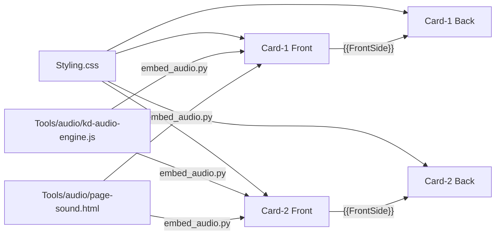

# Templates – Aufbau und Wegweiser

Entwickler-Dokumentation zum Notiztyp **KanjiDraw**. Die Bedienung erklärt das [README im Hauptordner](../README.md).

> Die Zeilennummern in diesen Dateien gelten für den Commit, mit dem sie zuletzt aktualisiert wurden. Nach Änderungen verschieben sie sich.
> Verlässlich sind die **Suchbegriffe** (Kommentar-Überschriften, Funktionsnamen, IDs).

## Dateien

| Datei | Größe | Inhalt | Karte |
|---|---|---|---|
| [Card-1/FrontTemplate.html](Card-1/FrontTemplate.html) | ~9 300 Z. / 627 KB | Zeichenkarte: Einstellungen, Landschaften, Zeichenfläche, Bewertung, Audio-Engine | [Card-1/README.md](Card-1/README.md) |
| [Card-1/BackTemplate.html](Card-1/BackTemplate.html) | ~4 200 Z. / 245 KB | Rückseite der Zeichenkarte: Strichfarben, Freimodus-Auswertung, Info-Modal | [Card-1/README.md](Card-1/README.md) |
| [Card-2/FrontTemplate.html](Card-2/FrontTemplate.html) | ~7 700 Z. / 535 KB | Erkennungskarte: zeigt das fertige Kanji, sonst wie Card-1 ohne Zeichen-Engine | [Card-2/README.md](Card-2/README.md) |
| [Card-2/BackTemplate.html](Card-2/BackTemplate.html) | ~2 600 Z. / 133 KB | Rückseite der Erkennungskarte | [Card-2/README.md](Card-2/README.md) |
| [Styling.css](Styling.css) | ~6 000 Z. / 148 KB | Gemeinsames Stylesheet aller vier Templates | unten |

## Wie Anki die Dateien zusammensetzt

- **Rückseite = Vorderseite + Zusatz.** Jede BackTemplate bindet ihre Vorderseite über `{{FrontSide}}` ein. Alle Funktionen der Vorderseite stehen der Rückseite zur Verfügung, etwa `safeGetItem`, `getGlobalConfig`, `applyThemeSettings`, die gemeinsamen Helfer (`_kanjiIsDark` …) und die Audio-Engine. Die Rückseite erkennt sich an `#is-back-side-marker`.
- **Das Dokument bleibt bestehen (Anki Desktop, AnkiMobile).** Beim Kartenwechsel wird nur `#qa` ersetzt. Die Skripte laufen erneut, `window` bleibt erhalten. Deshalb:
  - Globale Listener werden vor dem erneuten Anmelden entfernt (`if (window._kanjiX) removeEventListener(…)`) oder per Flag nur einmal gebunden (`window._kanjiGlobalPenDefenseAdded`, `window._kdSndUiBound`).
  - Beide Karten verwenden dieselben globalen Handler-Namen. So ersetzt jede Karte die Handler der anderen, statt sie zusätzlich zu binden.
  - Laufende Animationen werden über Generationszähler abgebrochen (`window._kanjiDrawGen`, `_kanjiSrGenC1/C2`).
- **AnkiDroid** lädt die Seite pro Karte neu. Zustand, der den Wechsel überleben soll, liegt in `sessionStorage`/`localStorage`.
- **Kein Include-Mechanismus.** Anki kann keine gemeinsamen Dateien einbinden. Gemeinsamer Code wird deshalb **kopiert** und mit `[SHARED c1-front/c2-front]` bzw. `[SHARED with c2-back]` markiert. Wer einen solchen Block ändert, muss die andere Karte mitziehen.

## Gemeinsame Helfer (`Shared helpers [SHARED c1-front/c2-front]`)

Stehen in beiden Vorderseiten direkt nach dem „Persistence Layer“ und sind damit auch auf den Rückseiten verfügbar.

| Funktion | Zweck |
|---|---|
| `window._kanjiIsDark()` | Dunkelmodus aktiv? (`nightMode`/`night_mode` an `html` oder `body`) |
| `window._kanjiSwFactor(v)` | Strichbreite `thin`/`thick`/sonst → 0.7 / 1.4 / 1 |
| `window._kanjiGelColor(refPath, cache)` | Farbe des Gelstift-Halos für einen Referenzpfad |
| `window._kanjiMakeGelHalo(refPath, color, swf, opacity)` | Erzeugt den Halo-Pfad (noch nicht eingefügt) |
| `window._kanjiEatNextClick()` | Schluckt den nächsten Geisterklick nach einer Stift-Geste |

## Generierte Blöcke (nicht von Hand bearbeiten)

| Marker | Quelle | Inhalt |
|---|---|---|
| `<!-- [KD-AUDIO-ENGINE] -->` … `<!-- [/KD-AUDIO-ENGINE] -->` | [../Tools/audio/kd-audio-engine.js](../Tools/audio/kd-audio-engine.js) | Prozedurale Musik, Strich- und Effektklänge (`window.__kdAudio`) |
| `<!-- [KD-SOUND-PAGE] -->` … `<!-- [/KD-SOUND-PAGE] -->` | [../Tools/audio/page-sound.html](../Tools/audio/page-sound.html) | Einstellungsseite „Klang & Musik“ |

Eingebettet werden beide mit `python3 Tools/audio/embed_audio.py`. Das Skript ist idempotent und ersetzt nur den Inhalt zwischen den Markern. Tests und Werkzeuge beschreibt [../Tools/audio/README.md](../Tools/audio/README.md).

## Einstellungen und Speicher

- **Lesen und Schreiben:** `safeGetItem(key, default)` / `safeSetItem(key, value)` in „Persistence Layer [SHARED]“ der Vorderseiten.
  - Lesereihenfolge: `window._ks` (vom Add-on injiziert) → Cookie `_k` (geparst von `_kCookieObj`) → `localStorage`.
  - Auf Anki Desktop schickt `pycmd('kdp:' + JSON)` den Stand an das Add-on [Kanji Draw Persistence](../Addon/README.md).
- **Schlüssel:** `kanji*` (global, z. B. `kanjiThemePrimary`, `kanjiSoundMusic`).
  - Kartenbezogene Varianten: `c1_kanji*`, `c2_kanji*`, `c2f_kanji*` (Vorderseite Erkennen).
  - `scopedGet()` bzw. `hostGet()` in „Settings UI [SHARED]“ lösen den Bereich auf.
- **Sitzungszustand:**
  - `kanjiErrors`, `kanjiFreeStrokes` (Fehler und Freimodus-Striche, für die Rückseite).
  - `kdPal:<theme>:<d|n>` (Farbpalette, gegen Flackern).
  - `kdAudioState` (Musikübergang).

## Wo ändere ich was?

| Ich will … | Datei | Suchbegriff |
|---|---|---|
| eine Einstellung hinzufügen | beide FrontTemplates: HTML-Seite `id="page-…"`, dazu `refreshSettingsRadios`, `updateFeatureSetting` bzw. `updateThemeSetting` | `Sub-Page:` |
| die Strichbewertung (geführter Modus) anpassen | Card-1/FrontTemplate.html | `const evaluateStroke` |
| die Freimodus-Auswertung (Rückseite) anpassen | Card-1/BackTemplate.html | `FREE MODE: Evaluation` |
| Algorithmen (Resampling, Fréchet, Ungarische Methode, Abstands-/Winkelmaße) ändern | Card-1/FrontTemplate.html | `Shared Scoring Algorithms` (`window._kanjiAlgo`) |
| Dunkelmodus-Prüfung, Strichbreite, Gelstift-Halo oder Klick-Schlucken ändern | beide FrontTemplates | `Shared helpers [SHARED` |
| Farben und Landschaften eines Themes ändern | Styling.css `Theme: …` plus SVG `jp-scene-<theme>` in beiden FrontTemplates | `data-jp-theme` |
| die Akzent- und Hauptfarben (Swatches) ändern | beide FrontTemplates | `Theme: Accent color definitions` |
| Musik und Klänge ändern | `Tools/audio/kd-audio-engine.js`, danach `embed_audio.py` | – |
| den Radikal-Baum der Rückseite ändern | beide BackTemplates | `Primitive Tree (Kanji-Study style)` |
| die Schreibfehler-Seite ändern | beide BackTemplates | `Pitfalls ("Häufige Schreibfehler"` |
| den Strichfolge-Player ändern | beide BackTemplates | `Stroke-Order Player` |
| Fixes für Stift, S-Pen oder Apple Pencil ändern | alle vier Templates | `S-Pen`, `Apple Pencil`, `addPenHandler` |

## Styling.css – Abschnitte

| Zeilen | Abschnitt (Suchbegriff) | Inhalt |
|---|---|---|
| 1–84 | `DEINE DAUERHAFTEN EINSTELLUNGEN` | Benutzer-Defaults als CSS-Variablen |
| 85–279 | `1. CSS Variables & Theming` | Farbvariablen Tag/Nacht, AnkiWeb-Sonderregeln (158–226), Nachtfarben (227) |
| 280–818 | `2. Global Layout & Typography` | `html`/`body`/`.card` (345), Hintergrundebene `.card::before` (379), Einblend-Animationen `kdFadeIn`/`kdRiseIn` (389), Landschaftsbühne `.forest-scenery` (436), Tag/Nacht-Ebenen (457), Nachtszene (661) |
| 819–1973 | `2b. Selectable Japanese Regional Landscapes` | Sichtbarkeit `.jp-scene-<theme>` (824–863), gemeinsame Paletten (864), danach je Theme: rose 991, neutral 1097, sepia 1137, cool 1288, warm 1394, sage 1508, hokkaido 1614, tokyo 1762, okinawa 1868 |
| 1974–2009 | Button-Reset, `.card-title` | Kartentitel als Pille |
| 2010–2339 | `3. Kanji Canvas Container & SVG Grid` | Zeichenfläche, Ebenen, `#touch-shield` (2086), Warnbanner AnkiDroid-Gesten (2102) und fehlendes Add-on (2174) |
| 2340–2433 | `3a. Stroke Style Filters` | Gelstift, Tusche, Neon, Farbfelder |
| 2434–2474 | `3b. Completion Celebration` | Abschlussfeier |
| 2475–2764 | `4. UI Controls & Buttons` | Aktionsknöpfe, Zahnrad (2680), Tipp-Feedback |
| 2765–3058 | `5. Modals & Overlays` | Einstellungs- und Info-Overlay, Banner-Header, Icons |
| 3059–3563 | `5b. Settings Navigation` | Seiten-Slides, Segment-Schalter C1/C2, Kategoriekarten, Pastell-Icons, Akzent-Swatches (3393), Unterseiten-Header (3462) |
| 3564–3641 | `6. Stroke Logic` | Strich-Zustände, Hinweis- und Rückspul-Animation |
| 3642–4504 | `7. Backside Elements` | Info-Tags, Sprechblase, Story-Hervorhebungen `.kd-*` (ab 3773), Wortbeispiele, Info-Knopf, Aktionsleiste (4135), Schreibfehler-Seite (4203) |
| 4505–5005 | `7b. Kanji-Study-style Primitive Tree` | Radikal-Baum, Zoom-Knöpfe (4585), Vollbild (4634) |
| 5006–5066 | `Custom Overlay Scrollbars` | eigene Scrollleiste in Modals |
| 5067–5245 | `10. Free Canvas Mode` | `.setting-disabled` (5071), Handschrift-Overlay, Strichzahl-Badges, Umschalter Handschrift/SVG |
| 5246–5485 | `11. Font Size Scaling` | `.font-small` / `.font-large` |
| 5486–5540 | `12. WKWebView (AnkiMobile) GPU-safety overrides` | – |
| 5541–5794 | `12b. Start-Point Hint, Stroke-Order Player, Grade Recommendation` | Startpunkt-Puls, Strichfolge-Knopf und -Player |
| 5795–5927 | `S-Pen / Stylus explicit hover` | `.spen-hover` |
| 5928–5950 | `13. Reduced Motion` | `prefers-reduced-motion`, Anki-Option „Reduce motion“ |
| 5951–Ende | `S-Pen / Stylus hover fix` | – |

## Audio-Engine (`[KD-AUDIO-ENGINE]`)

Die Quelle ist [../Tools/audio/kd-audio-engine.js](../Tools/audio/kd-audio-engine.js) (1756 Z., Version 2.0.1). Zeile N der Quelle steht in Card-1/FrontTemplate.html in Zeile N + 4413 und in Card-2/FrontTemplate.html in Zeile N + 4374.

| Quelle | Abschnitt | Wichtigste Namen |
|---|---|---|
| 1–25 | Kopf, Versionsprüfung | `VERSION`, alte Instanz → `dispose()` |
| 26–124 | `── Tables` | `THEMES` (Tonleitern, Akkordfolgen), `ALT`, `STACKS`, `NAT` (Natur je Theme), `GENRES`, `SK` (Stiftklänge), `SPACE` (Raum), `VOPT`/`VREG`/`VK`/`STR` (Instrumente je Landschaft), `RES` |
| 125–144 | `── State` | `cfg`, `cur`, `scenes`, Timer, Szenenwechsel-Sperre (`DWELL`, `MINGAP`) |
| 145–243 | `── Context & master graph` | `ensureCtx`, `makeNoise`, `makeIR`, `buildGraph` (Hall, Echo, Kompressor) |
| 244–264 | `── Node helpers` | `gainN`, `filt`, `oscN`, `send` |
| 265–608 | `── Instruments` | Sample-Cache `SMP`/`warm`; Renderer `renderPiano`, `MODAL` (Glocken, Schalen, Suikinkutsu; `sr` je Instrument), `renderString` (Koto, Shamisen, Biwa …); Spieler `tone`, `pluck`, `flute`, `sho`, `piano`, `bowl`, `singBowl`, `kane`, `suikin` … |
| 609–650 | `── Harmony` | `chordOf`, `scaleNotes`, `voiceChord`, `pivotIndex` |
| 651–759 | `── Scenes` | `Scene` (Überblenden, `scheduleBar`, Songform A/B/C) |
| 760–984 | `── Genres` | `ambientBar`, `zenBar`, `pianoBar`, `lofiBar`; Phrasen `JP`, `jphrase`, `jvoice`, `lead` |
| 985–1266 | `── Nature soundscapes` | `natureStart`/`natureBar`, Tierstimmen, `EV`-Tabelle |
| 1267–1357 | `── Flow` | `energy`, `answer`, `ghost`, `penTick`, `arpLayer` |
| 1358–1423 | `── Music control` | `syncMusic` (inkl. Wechselsperre), `pump`, `tick` |
| 1424–1556 | `── Public operations` | `configure`, `setScene`, `cardShown`, `FX` (UI-Klänge), `strokeResult`, `complete` |
| 1557–1672 | `── Stroke sounds` | `strokeStart`/`buildStroke`/`strokeMove`/`strokeEnd` |
| 1673–1703 | `── Lifecycle` | Geste/Sichtbarkeit, Leerlauf-Suspend, `dispose` |
| 1704–1756 | `── Offline render`, API | `offline` (Tests), `api` → `window.__kdAudio` |

Die Templates sprechen die Engine nur über `_kdSnd(method, …)` an („Klang & Musik: Bridge“ in den FrontTemplates).

## Code-Review: Stand

**Behoben**
- Die Audio-Werkzeuge liegen jetzt im Repository unter [../Tools/audio/](../Tools/audio/README.md).
- Speicher der Audio-Samples: Glocken (`kane`) und Klangschalen (`bowl`) werden mit 11 025 Hz statt 22 050 Hz gerendert. Das halbiert ihren Anteil am Sample-Cache; hörbar ist das bei diesen tiefen Klängen nicht.
- Dead Code in der Engine entfernt: `MODAL.kalimba`, `CH.ms11`, die Szenenfelder `hiVoice`/`lastMel`/`motif` und die ungenutzte Berechnung in `zenBar`.
- Gemeinsame Helfer statt Kopien (siehe oben). Abgeglichene Blöcke zwischen den Karten: siehe [Card-2/README.md](Card-2/README.md#abgleich-mit-card-1).
- CSS: Selektoren ohne Verwendung entfernt:
  - `.fs-sparkle`, `.fs-water-deep`, `.order-overlay`
  - `.pi-*`, `.primary-swatch-*`
  - `.label-on`/`.label-kun`
  - `.pitfall-card-head/-title/-desc`
  - `.show-tooltip`, `.tooltip-dismissed` (Regeln mit `:not(.tooltip-dismissed)` bleiben)
  - `.primitive-tag-icon`, `.custom-svg-icon`, `.kanji-stroke-format`, `.font-stroke-format`
- Die doppelte Regel `.tree-container.tree-graph-mode` ist zusammengeführt.

**Offen** (bewusst nicht angefasst)
1. **Jede Karte parst ~600 KB HTML, auf der Rückseite noch einmal**, wegen `{{FrontSide}}`. Allein die neun Landschaften sind ~207 KB SVG (Card-1 Z. 1483–4281). Sichtbar ist immer nur eine, die anderen hängen mit `display:none` im DOM.
   - Möglicher Weg: Szenen als `<template id="scene-…">` ablegen und nur die aktive klonen.
   - Das berührt Theme-Wechsel, Vorab-Palette und Nachtmodus auf allen Plattformen. Ohne Sichtprüfung auf AnkiMobile und AnkiDroid ist es zu riskant.
2. **CSS:** `.card` und `.gear-btn` stehen zusätzlich in Media-Queries (2706, 2713). Das sind gewollte Überschreibungen, keine Duplikate.
   - Die 18 einzelnen `@media (hover: hover)`-Blöcke stehen jeweils bei ihrem Bauteil. Ein Zusammenlegen würde die Lesbarkeit verschlechtern und ändert nichts an der Geschwindigkeit.
