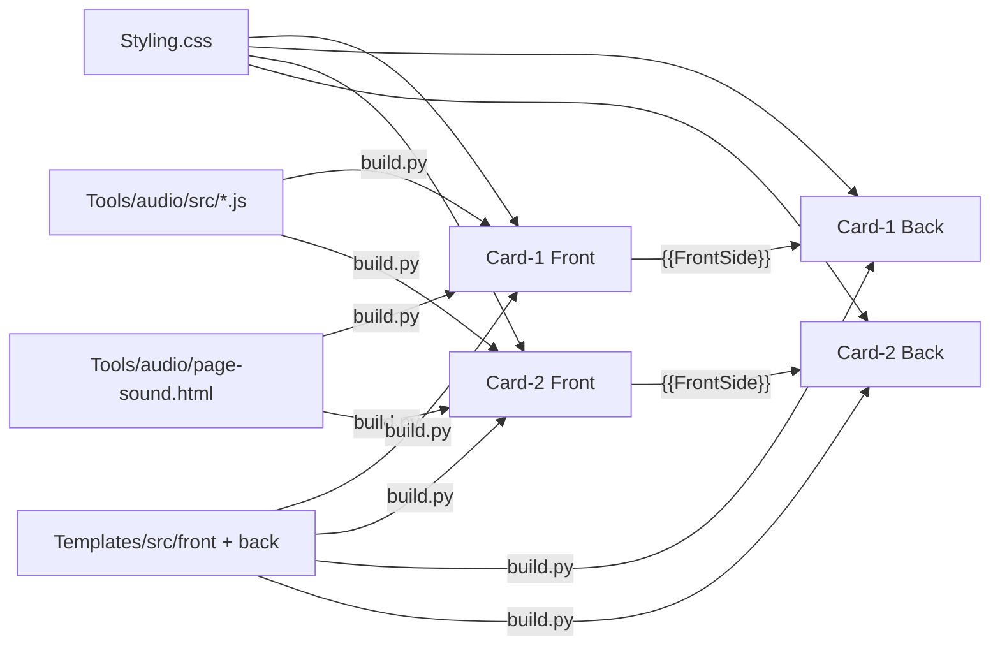
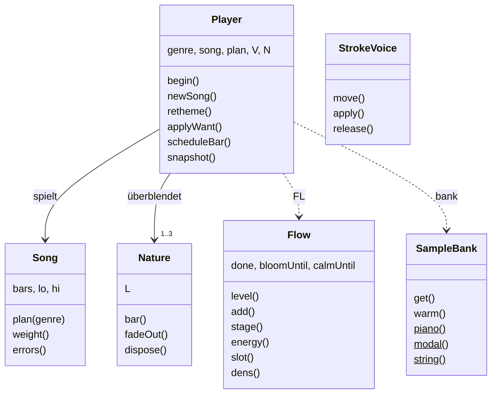

# Templates – Aufbau und Wegweiser

Entwickler-Dokumentation zum Notiztyp **KanjiDraw**. Die Bedienung erklärt das [README im Hauptordner](../README.md).

> Die Zeilennummern in diesen Dateien gelten für den Commit, mit dem sie zuletzt aktualisiert wurden. Nach Änderungen verschieben sie sich.
> Verlässlich sind die **Suchbegriffe** (Kommentar-Überschriften, Funktionsnamen, IDs).

## Dateien

| Datei | Größe | Inhalt | Karte |
|---|---|---|---|
| [Card-1/FrontTemplate.html](Card-1/FrontTemplate.html) | ~9 600 Z. / 643 KB | Zeichenkarte: Einstellungen, Landschaften, Zeichenfläche, Bewertung, Audio-Engine | [Card-1/README.md](Card-1/README.md) |
| [Card-1/BackTemplate.html](Card-1/BackTemplate.html) | ~4 200 Z. / 245 KB | Rückseite der Zeichenkarte: Strichfarben, Freimodus-Auswertung, Info-Modal | [Card-1/README.md](Card-1/README.md) |
| [Card-2/FrontTemplate.html](Card-2/FrontTemplate.html) | ~8 000 Z. / 550 KB | Erkennungskarte: zeigt das fertige Kanji, sonst wie Card-1 ohne Zeichen-Engine | [Card-2/README.md](Card-2/README.md) |
| [Card-2/BackTemplate.html](Card-2/BackTemplate.html) | ~2 600 Z. / 133 KB | Rückseite der Erkennungskarte | [Card-2/README.md](Card-2/README.md) |
| [Styling.css](Styling.css) | ~6 000 Z. / 148 KB | Gemeinsames Stylesheet aller vier Templates | unten |
| [src/](src/) | 12 Dateien | **Quellen** des Codes, der in beiden Karten gleich ist; `Tools/build.py` setzt sie ein | [unten](#generierte-blöcke-nicht-von-hand-bearbeiten) |

## Wie Anki die Dateien zusammensetzt

- **Rückseite = Vorderseite + Zusatz.** Jede BackTemplate bindet ihre Vorderseite über `{{FrontSide}}` ein. Alle Funktionen der Vorderseite stehen der Rückseite zur Verfügung, etwa `safeGetItem`, `getGlobalConfig`, `applyThemeSettings`, die gemeinsamen Helfer (`_kanjiIsDark` …) und die Audio-Engine. Die Rückseite erkennt sich an `#is-back-side-marker`.
- **Das Dokument bleibt bestehen (Anki Desktop, AnkiMobile).** Beim Kartenwechsel wird nur `#qa` ersetzt. Die Skripte laufen erneut, `window` bleibt erhalten. Deshalb:
  - Globale Listener werden vor dem erneuten Anmelden entfernt (`if (window._kanjiX) removeEventListener(…)`) oder per Flag nur einmal gebunden (`window._kanjiGlobalPenDefenseAdded`, `window._kdSndUiBound`).
  - Beide Karten verwenden dieselben globalen Handler-Namen. So ersetzt jede Karte die Handler der anderen, statt sie zusätzlich zu binden.
  - Laufende Animationen werden über Generationszähler abgebrochen (`window._kanjiDrawGen`, `_kanjiSrGenC1/C2`).
- **AnkiDroid** lädt die Seite pro Karte neu. Zustand, der den Wechsel überleben soll, liegt in `sessionStorage`/`localStorage`.
- **Kein Include-Mechanismus.** Anki kann keine gemeinsamen Dateien einbinden. Code, der in beiden Karten gleich ist, liegt deshalb einmal unter [src/](src/) und wird von `python3 Tools/build.py` zwischen die Marker `// [KD-SRC <datei>]` … `// [/KD-SRC <datei>]` kopiert (siehe unten). Blöcke, die sich zwischen den Karten noch unterscheiden, sind weiter mit `[SHARED …]` markiert und müssen von Hand mitgezogen werden.

## Gemeinsame Helfer (`src/front/shared-helpers.js`)

Stehen in beiden Vorderseiten direkt nach dem „Persistence Layer“ und sind damit auch auf den Rückseiten verfügbar.

| Funktion | Zweck |
|---|---|
| `window._kanjiIsDark()` | Dunkelmodus aktiv? (`nightMode`/`night_mode` an `html` oder `body`) |
| `window._kanjiSwFactor(v)` | Strichbreite `thin`/`thick`/sonst → 0.7 / 1.4 / 1 |
| `window._kanjiGelColor(refPath, cache)` | Farbe des Gelstift-Halos für einen Referenzpfad |
| `window._kanjiMakeGelHalo(refPath, color, swf, opacity)` | Erzeugt den Halo-Pfad (noch nicht eingefügt) |
| `window._kanjiEatNextClick()` | Schluckt den nächsten Geisterklick nach einer Stift-Geste |

## Generierte Blöcke (nicht von Hand bearbeiten)

| Marker | Quelle | Inhalt |
|---|---|---|
| `<!-- [KD-AUDIO-ENGINE] -->` … `<!-- [/KD-AUDIO-ENGINE] -->` | [../Tools/audio/src/](../Tools/audio/src/) (gebündelt zu [kd-audio-engine.js](../Tools/audio/kd-audio-engine.js)) | Prozedurale Musik, Strich- und Effektklänge (`window.__kdAudio`) |
| `<!-- [KD-SOUND-PAGE] -->` … `<!-- [/KD-SOUND-PAGE] -->` | [../Tools/audio/page-sound.html](../Tools/audio/page-sound.html) | Einstellungsseite „Klang & Musik“ |
| `// [KD-SRC front/<datei>]` … `// [/KD-SRC …]` | [src/front/](src/front/) | In beiden Vorderseiten: `persistence.js`, `shared-helpers.js`, `sound-bridge.js`, `grid-display.js`, `scroll-guards.js` |
| `// [KD-SRC back/<datei>]` … `// [/KD-SRC …]` | [src/back/](src/back/) | In beiden Rückseiten: `primitive-tree.js`, `radical-tree.js`, `pitfalls.js`, `word-examples.js`, `hide-readings.js`, `stroke-order-player.js`, `cross-platform.js` |

Alles erzeugt `python3 Tools/build.py`. Das Skript ist idempotent, ersetzt nur den Inhalt zwischen den Markern und rückt die Quelle wie den Marker ein; `--check` meldet veraltete Templates (Exit-Code 1). In Quellen verboten sind `{{`, `}}` und `</script` (Anki-Feldsyntax bzw. Skriptende). Tests und Werkzeuge der Engine beschreibt [../Tools/audio/README.md](../Tools/audio/README.md).

## Einstellungen und Speicher

- **Lesen und Schreiben:** `safeGetItem(key, default)` / `safeSetItem(key, value)` in [src/front/persistence.js](src/front/persistence.js).
  - Lesereihenfolge: `window._ks` (vom Add-on injiziert) → Cookie `_k` (geparst von `_kCookieObj`) → `localStorage`.
  - Auf Anki Desktop schickt `pycmd('kdp:' + JSON)` den Stand an das Add-on [Kanji Draw Persistence](../Addon/README.md).
- **Schlüssel:** `kanji*` (global, z. B. `kanjiThemePrimary`, `kanjiSoundMusic`).
  - Kartenbezogene Varianten: `c1_kanji*`, `c2_kanji*`, `c2f_kanji*` (Vorderseite Erkennen).
  - `scopedGet()` bzw. `hostGet()` in „Settings UI [SHARED]“ lösen den Bereich auf.
- **Sitzungszustand:**
  - `kanjiErrors`, `kanjiFreeStrokes` (Fehler und Freimodus-Striche, für die Rückseite).
  - `kdPal:<theme>:<d|n>` (Farbpalette, gegen Flackern).
  - `kdAudioState` (Musikübergang).

## Wo ändere ich was?

| Ich will … | Datei | Suchbegriff |
|---|---|---|
| eine Einstellung hinzufügen | beide FrontTemplates: HTML-Seite `id="page-…"`, dazu `refreshSettingsRadios`, `updateFeatureSetting` bzw. `updateThemeSetting` | `Sub-Page:` |
| die Strichbewertung (geführter Modus) anpassen | Card-1/FrontTemplate.html | `const evaluateStroke` |
| die Freimodus-Auswertung (Rückseite) anpassen | Card-1/BackTemplate.html | `FREE MODE: Evaluation` |
| Algorithmen (Resampling, Fréchet, Ungarische Methode, Abstands-/Winkelmaße) ändern | Card-1/FrontTemplate.html | `Shared Scoring Algorithms` (`window._kanjiAlgo`) |
| Dunkelmodus-Prüfung, Strichbreite, Gelstift-Halo oder Klick-Schlucken ändern | `src/front/shared-helpers.js`, danach `build.py` | – |
| Farben und Landschaften eines Themes ändern | Styling.css `Theme: …` plus SVG `jp-scene-<theme>` in beiden FrontTemplates | `data-jp-theme` |
| die Akzent- und Hauptfarben (Swatches) ändern | beide FrontTemplates | `Theme: Accent color definitions` |
| Musik und Klänge ändern | `Tools/audio/src/` (Modulübersicht in [../Tools/audio/README.md](../Tools/audio/README.md#module-src)), danach `build.py` | – |
| den Radikal-Baum der Rückseite ändern | `src/back/primitive-tree.js`, danach `build.py` | – |
| die Schreibfehler-Seite ändern | `src/back/pitfalls.js`, danach `build.py` | – |
| den Strichfolge-Player ändern | `src/back/stroke-order-player.js`, danach `build.py` | – |
| Fixes für Stift, S-Pen oder Apple Pencil ändern | alle vier Templates | `S-Pen`, `Apple Pencil`, `addPenHandler` |

## Styling.css – Abschnitte

| Zeilen | Abschnitt (Suchbegriff) | Inhalt |
|---|---|---|
| 1–87 | `DEINE DAUERHAFTEN EINSTELLUNGEN` | Benutzer-Defaults als CSS-Variablen |
| 88–282 | `1. CSS Variables & Theming` | Farbvariablen Tag/Nacht, AnkiWeb-Sonderregeln (161–229), Nachtfarben (230) |
| 283–821 | `2. Global Layout & Typography` | `html`/`body`/`.card` (348), Hintergrundebene `.card::before` (382), Einblend-Animationen `kdFadeIn`/`kdRiseIn` (392), Landschaftsbühne `.forest-scenery` (439), Tag/Nacht-Ebenen (460), Nachtszene (664) |
| 822–1976 | `2b. Selectable Japanese Regional Landscapes` | Sichtbarkeit `.jp-scene-<theme>` (827–866), gemeinsame Paletten (867), danach je Theme: rose 994, neutral 1100, sepia 1140, cool 1291, warm 1397, sage 1511, hokkaido 1617, tokyo 1765, okinawa 1871 |
| 1977–2012 | Button-Reset, `.card-title` | Kartentitel als Pille |
| 2013–2342 | `3. Kanji Canvas Container & SVG Grid` | Zeichenfläche, Ebenen, `#touch-shield` (2089), Warnbanner AnkiDroid-Gesten (2105) und fehlendes Add-on (2177) |
| 2343–2436 | `3a. Stroke Style Filters` | Gelstift, Tusche, Neon, Farbfelder |
| 2437–2477 | `3b. Completion Celebration` | Abschlussfeier |
| 2478–2767 | `4. UI Controls & Buttons` | Aktionsknöpfe, Zahnrad (2683), Tipp-Feedback |
| 2768–3061 | `5. Modals & Overlays` | Einstellungs- und Info-Overlay, Banner-Header, Icons |
| 3062–3566 | `5b. Settings Navigation` | Seiten-Slides, Segment-Schalter C1/C2, Kategoriekarten, Pastell-Icons, Akzent-Swatches (3396), Unterseiten-Header (3465) |
| 3567–3644 | `6. Stroke Logic` | Strich-Zustände, Hinweis- und Rückspul-Animation |
| 3645–4507 | `7. Backside Elements` | Info-Tags, Sprechblase, Story-Hervorhebungen `.kd-*` (ab 3776), Wortbeispiele, Info-Knopf, Aktionsleiste (4138), Schreibfehler-Seite (4206) |
| 4508–5008 | `7b. Kanji-Study-style Primitive Tree` | Radikal-Baum, Zoom-Knöpfe (4588), Vollbild (4637) |
| 5009–5069 | `Custom Overlay Scrollbars` | eigene Scrollleiste in Modals |
| 5070–5248 | `10. Free Canvas Mode` | `.setting-disabled` (5074), Handschrift-Overlay, Strichzahl-Badges, Umschalter Handschrift/SVG |
| 5249–5488 | `11. Font Size Scaling` | `.font-small` / `.font-large` |
| 5489–5543 | `12. WKWebView (AnkiMobile) GPU-safety overrides` | – |
| 5544–5811 | `12b. Start-Point Hint, Stroke-Order Player, Grade Recommendation` | Startpunkt-Puls, Strichfolge-Knopf und -Player |
| 5812–5944 | `S-Pen / Stylus explicit hover` | `.spen-hover` |
| 5945–5967 | `13. Reduced Motion` | `prefers-reduced-motion`, Anki-Option „Reduce motion“ |
| 5968–Ende | `S-Pen / Stylus hover fix` | – |

## Audio-Engine (`[KD-AUDIO-ENGINE]`)

Die Quelle liegt in Modulen unter [../Tools/audio/src/](../Tools/audio/src/) (Version 1.1.0, Modulübersicht in [../Tools/audio/README.md](../Tools/audio/README.md#module-src)). `Tools/build.py` bündelt sie zu einer IIFE ([kd-audio-engine.js](../Tools/audio/kd-audio-engine.js)) und setzt diese in beide Vorderseiten ein; jedes Modul beginnt dort mit dem Kommentar `// ── <modul>.js`.

Musikalisches Prinzip: ein **Repertoire echter Lieder** (`SONGS`: gemeinfreie Klassiker wie Sakura Sakura, Kōjō no Tsuki, Tōryanse, Furusato, Nanatsu no Ko sowie eigene Stücke in Ryukyu-, Min'yō-, In- und Yo-Tonleiter). Jedes Lied läuft als Vorspiel → Strophen mit wechselnder Behandlung (`Song.plan`: verziert, Heterophonie, Ruf/Antwort, oktaviert, Fragment) → Zwischenspiel → Nachspiel → Ma. **Die Landschaft färbt nur** (`retheme`/`applyWant`: Instrumentenpaar ab dem nächsten Abschnitt, Raum, Helligkeit, Naturkulisse, Schlagwerk); Lied, Tonart und Tempo bleiben, auch beim Genrewechsel und nach einem Seiten-Reload (`snapshot`/`kdAudioState`). **Jo-Ha-Kyū** und der Lernfluss (`class Flow`: `stage()`, `energy()`) steuern die Dichte; Treffer-Töne werden auf Achtel gerastert und bei schnellem Zeichnen zusammengefasst (`Flow.slot`, `Flow.dens`).

Neues Lied hinzufügen: Eintrag in `SONGS` in `03-repertoire.js` (`mel` als `Halbtöne:Schläge`, `ch` ein Akkord je Takt), dann im Selbsttest `songs` prüfen – die Zeile muss `[]` zeigen.

Die Templates sprechen die Engine nur über `_kdSnd(method, …)` an ([src/front/sound-bridge.js](src/front/sound-bridge.js)).

## Code-Review: Stand

**Behoben**
- Die Audio-Werkzeuge liegen jetzt im Repository unter [../Tools/audio/](../Tools/audio/README.md).
- Speicher der Audio-Samples: Glocken (`kane`) und Klangschalen (`bowl`) werden mit 11 025 Hz statt 22 050 Hz gerendert. Das halbiert ihren Anteil am Sample-Cache; hörbar ist das bei diesen tiefen Klängen nicht.
- Gemeinsame Helfer statt Kopien (siehe oben). Abgeglichene Blöcke zwischen den Karten: siehe [Card-2/README.md](Card-2/README.md#abgleich-mit-card-1).
- CSS: Selektoren ohne Verwendung entfernt:
  - `.fs-sparkle`, `.fs-water-deep`, `.order-overlay`
  - `.pi-*`, `.primary-swatch-*`
  - `.label-on`/`.label-kun`
  - `.pitfall-card-head/-title/-desc`
  - `.show-tooltip`, `.tooltip-dismissed` (Regeln mit `:not(.tooltip-dismissed)` bleiben)
  - `.primitive-tag-icon`, `.custom-svg-icon`, `.kanji-stroke-format`, `.font-stroke-format`
- Die doppelte Regel `.tree-container.tree-graph-mode` ist zusammengeführt.

**Offen** (bewusst nicht angefasst)
1. **Jede Karte parst ~600 KB HTML, auf der Rückseite noch einmal**, wegen `{{FrontSide}}`. Allein die neun Landschaften sind ~207 KB SVG (Card-1 Z. 1511–4309). Sichtbar ist immer nur eine, die anderen hängen mit `display:none` im DOM.
   - Möglicher Weg: Szenen als `<template id="scene-…">` ablegen und nur die aktive klonen.
   - Das berührt Theme-Wechsel, Vorab-Palette und Nachtmodus auf allen Plattformen. Ohne Sichtprüfung auf AnkiMobile und AnkiDroid ist es zu riskant.
2. **CSS:** `.card` und `.gear-btn` stehen zusätzlich in Media-Queries (2709, 2716). Das sind gewollte Überschreibungen, keine Duplikate.
   - Die 18 einzelnen `@media (hover: hover)`-Blöcke stehen jeweils bei ihrem Bauteil. Ein Zusammenlegen würde die Lesbarkeit verschlechtern und ändert nichts an der Geschwindigkeit.
