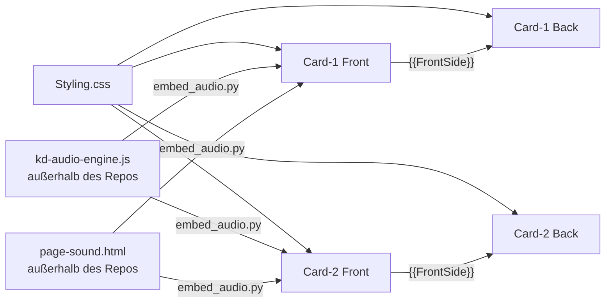

# Templates – Aufbau und Wegweiser

Entwickler-Dokumentation zum Notiztyp **KanjiDraw**. Die Bedienung erklärt das [README im Hauptordner](../README.md).

> Die Zeilennummern in diesen Dateien gelten für Commit `46fc277`. Nach Änderungen verschieben sie sich.
> Verlässlich sind die **Suchbegriffe** (Kommentar-Überschriften, Funktionsnamen, IDs).

## Dateien

| Datei | Größe | Inhalt | Karte |
|---|---|---|---|
| [Card-1/FrontTemplate.html](Card-1/FrontTemplate.html) | ~9 300 Z. / 614 KB | Zeichenkarte: Einstellungen, Landschaften, Zeichenfläche, Bewertung, Audio-Engine | [Card-1/README.md](Card-1/README.md) |
| [Card-1/BackTemplate.html](Card-1/BackTemplate.html) | ~4 200 Z. / 243 KB | Rückseite der Zeichenkarte: Strichfarben, Freimodus-Auswertung, Info-Modal | [Card-1/README.md](Card-1/README.md) |
| [Card-2/FrontTemplate.html](Card-2/FrontTemplate.html) | ~7 700 Z. / 523 KB | Erkennungskarte: zeigt das fertige Kanji, sonst wie Card-1 ohne Zeichen-Engine | [Card-2/README.md](Card-2/README.md) |
| [Card-2/BackTemplate.html](Card-2/BackTemplate.html) | ~2 600 Z. / 133 KB | Rückseite der Erkennungskarte | [Card-2/README.md](Card-2/README.md) |
| [Styling.css](Styling.css) | ~6 100 Z. / 149 KB | Gemeinsames Stylesheet aller vier Templates | unten |

## Wie Anki die Dateien zusammensetzt

- **Rückseite = Vorderseite + Zusatz.** Jede BackTemplate bindet ihre Vorderseite über `{{FrontSide}}` ein. Alle Funktionen der Vorderseite stehen der Rückseite zur Verfügung, etwa `safeGetItem`, `getGlobalConfig`, `applyThemeSettings` und die Audio-Engine. Die Rückseite erkennt sich an `#is-back-side-marker`.
- **Das Dokument bleibt bestehen (Anki Desktop, AnkiMobile).** Beim Kartenwechsel wird nur `#qa` ersetzt, die Skripte laufen erneut, `window` bleibt erhalten. Deshalb:
  - Globale Listener werden vor dem erneuten Anmelden entfernt (`if (window._kanjiX) removeEventListener(…)`) oder per Flag nur einmal gebunden (`window._kanjiGlobalPenDefenseAdded`, `window._kdSndUiBound`).
  - Laufende Animationen werden über Generationszähler abgebrochen (`window._kanjiDrawGen`, `_kanjiSrGenC1/C2`).
- **AnkiDroid** lädt die Seite pro Karte neu. Zustand, der den Wechsel überleben soll, liegt in `sessionStorage`/`localStorage`.
- **Kein Include-Mechanismus.** Anki kann keine gemeinsamen Dateien einbinden. Gemeinsamer Code wird deshalb **kopiert** und mit `[SHARED c1-front/c2-front]` bzw. `[SHARED with c2-back]` markiert. Wer einen solchen Block ändert, muss die andere Karte mitziehen.

## Generierte Blöcke (nicht von Hand bearbeiten)

| Marker | Quelle | Inhalt |
|---|---|---|
| `<!-- [KD-AUDIO-ENGINE] -->` … `<!-- [/KD-AUDIO-ENGINE] -->` | `~/kanji-draw-work/audio/kd-audio-engine.js` | Prozedurale Musik, Strich- und Effektklänge (`window.__kdAudio`) |
| `<!-- [KD-SOUND-PAGE] -->` … `<!-- [/KD-SOUND-PAGE] -->` | `~/kanji-draw-work/audio/page-sound.html` | Einstellungsseite „Klang & Musik“ |

Eingebettet werden beide mit `python3 ~/kanji-draw-work/audio/embed_audio.py`. Das Skript ist idempotent und ersetzt nur den Inhalt zwischen den Markern. Die Quellen liegen derzeit **nicht im Repository** (siehe Befunde).

## Einstellungen und Speicher

- **Lesen und Schreiben:** `safeGetItem(key, default)` / `safeSetItem(key, value)` in „Persistence Layer [SHARED]“ der Vorderseiten.
  - Lesereihenfolge: `window._ks` (vom Add-on injiziert) → Cookie `_k` → `localStorage`.
  - Auf Anki Desktop schickt `pycmd('kdp:' + JSON)` den Stand an das Add-on [Kanji Draw Persistence](../Addon/README.md).
- **Schlüssel:** `kanji*` (global, z. B. `kanjiThemePrimary`, `kanjiSoundMusic`).
  - Kartenbezogene Varianten: `c1_kanji*`, `c2_kanji*`, `c2f_kanji*` (Vorderseite Erkennen).
  - `scopedGet()` bzw. `hostGet()` in „Settings UI [SHARED]“ lösen den Bereich auf.
- **Sitzungszustand:**
  - `kanjiErrors`, `kanjiFreeStrokes` (Fehler und Freimodus-Striche, für die Rückseite).
  - `kdPal:<theme>:<d|n>` (Farbpalette, gegen Flackern).
  - `kdAudioState` (Musikübergang).

## Wo ändere ich was?

| Ich will … | Datei | Suchbegriff |
|---|---|---|
| eine Einstellung hinzufügen | beide FrontTemplates: HTML-Seite `id="page-…"`, dazu `refreshSettingsRadios`, `updateFeatureSetting` bzw. `updateThemeSetting` | `Sub-Page:` |
| die Strichbewertung (geführter Modus) anpassen | Card-1/FrontTemplate.html | `const evaluateStroke` |
| die Freimodus-Auswertung (Rückseite) anpassen | Card-1/BackTemplate.html | `FREE MODE: Evaluation` |
| Algorithmen (Resampling, Fréchet, Ungarische Methode) ändern | Card-1/FrontTemplate.html | `Shared Scoring Algorithms` (`window._kanjiAlgo`) |
| Farben und Landschaften eines Themes ändern | Styling.css `Theme: …` plus SVG `jp-scene-<theme>` in beiden FrontTemplates | `data-jp-theme` |
| die Akzent- und Hauptfarben (Swatches) ändern | beide FrontTemplates | `Theme: Accent color definitions` |
| Musik und Klänge ändern | `~/kanji-draw-work/audio/kd-audio-engine.js`, danach `embed_audio.py` | – |
| den Radikal-Baum der Rückseite ändern | beide BackTemplates | `Primitive Tree (Kanji-Study style)` |
| die Schreibfehler-Seite ändern | beide BackTemplates | `Pitfalls ("Häufige Schreibfehler"` |
| den Strichfolge-Player ändern | beide BackTemplates | `Stroke-Order Player` |
| Fixes für Stift, S-Pen oder Apple Pencil ändern | alle vier Templates | `S-Pen`, `Apple Pencil`, `addPenHandler` |

## Styling.css – Abschnitte

| Zeilen | Abschnitt (Suchbegriff) | Inhalt |
|---|---|---|
| 1–79 | `DEINE DAUERHAFTEN EINSTELLUNGEN` | Benutzer-Defaults als CSS-Variablen |
| 80–280 | `1. CSS Variables & Theming` | Farbvariablen Tag/Nacht, AnkiWeb-Sonderregeln (159–227), Nachtfarben (228) |
| 281–824 | `2. Global Layout & Typography` | `html`/`body`/`.card`, Hintergrundebene `.card::before`, Einblend-Animationen `kdFadeIn`/`kdRiseIn` (390), Landschaftsbühne `.forest-scenery` (437), Tag/Nacht-Ebenen (458), Nachtszene (667) |
| 825–1988 | `2b. Selectable Japanese Regional Landscapes` | Sichtbarkeit `.jp-scene-<theme>` (829–869), gemeinsame Paletten (870), danach je Theme: rose 1006, neutral 1112, sepia 1152, cool 1303, warm 1409, sage 1523, hokkaido 1629, tokyo 1777, okinawa 1883 |
| 1989–2024 | Button-Reset, `.card-title` | Kartentitel als Pille |
| 2025–2354 | `3. Kanji Canvas Container & SVG Grid` | Zeichenfläche, Ebenen, `#touch-shield` (2096), Warnbanner AnkiDroid-Gesten (2117) und fehlendes Add-on (2189) |
| 2355–2448 | `3a. Stroke Style Filters` | Gelstift, Tusche, Neon, Farbfelder |
| 2449–2489 | `3b. Completion Celebration` | Abschlussfeier |
| 2490–2779 | `4. UI Controls & Buttons` | Aktionsknöpfe, Zahnrad, Tipp-Feedback |
| 2780–3077 | `5. Modals & Overlays` | Einstellungs- und Info-Overlay, Banner-Header, Icons |
| 3078–3655 | `5b. Settings Navigation` | Seiten-Slides, Segment-Schalter C1/C2, Kategoriekarten, Pastell-Icons, Swatches, Unterseiten-Header |
| 3656–3733 | `6. Stroke Logic` | Strich-Zustände, Hinweis- und Rückspul-Animation |
| 3734–4636 | `7. Backside Elements` | Info-Tags, Sprechblase, Story-Hervorhebungen `.kd-*` (3865–3940), Wortbeispiele, Info-Knopf, Aktionsleiste (4229), Schreibfehler-Seite (4297) |
| 4637–5140 | `7b. Kanji-Study-style Primitive Tree` | Radikal-Baum, Zoom-Knöpfe (4720), Vollbild (4769) |
| 5141–5201 | `Custom Overlay Scrollbars` | eigene Scrollleiste in Modals |
| 5202–5228 | `9. Custom SVG Icon Styling` | Radikal-Icons |
| 5229–5407 | `10. Free Canvas Mode` | `.setting-disabled` (5233), Handschrift-Overlay, Strichzahl-Badges, Umschalter Handschrift/SVG |
| 5408–5647 | `11. Font Size Scaling` | `.font-small` / `.font-large` |
| 5648–5702 | `12. WKWebView (AnkiMobile) GPU-safety overrides` | – |
| 5703–5956 | `12b. Start-Point Hint, Stroke-Order Player, Grade Recommendation` | Startpunkt-Puls, Strichfolge-Knopf und -Player |
| 5957–6089 | `S-Pen / Stylus explicit hover` | `.spen-hover` |
| 6090–6112 | `13. Reduced Motion` | `prefers-reduced-motion`, Anki-Option „Reduce motion“ |
| 6113–Ende | `S-Pen / Stylus hover fix` | – |

## Audio-Engine (`[KD-AUDIO-ENGINE]`)

Die Quelle ist `~/kanji-draw-work/audio/kd-audio-engine.js` (1757 Z.). Die Zeile N der Quelle steht in Card-1/FrontTemplate.html in Zeile N + 4413 und in Card-2/FrontTemplate.html in Zeile N + 4367.

| Quelle | Abschnitt | Wichtigste Namen |
|---|---|---|
| 1–25 | Kopf, Versionsprüfung | `VERSION`, alte Instanz → `dispose()` |
| 26–124 | `── Tables` | `THEMES` (Tonleitern, Akkordfolgen), `ALT`, `STACKS`, `NAT` (Natur je Theme), `GENRES`, `SK` (Stiftklänge), `SPACE` (Raum), `VOPT`/`VREG`/`VK`/`STR` (Instrumente je Landschaft), `RES` |
| 125–144 | `── State` | `cfg`, `cur`, `scenes`, Timer, Szenenwechsel-Sperre (`DWELL`, `MINGAP`) |
| 145–243 | `── Context & master graph` | `ensureCtx`, `makeNoise`, `makeIR`, `buildGraph` (Hall, Echo, Kompressor) |
| 244–264 | `── Node helpers` | `gainN`, `filt`, `oscN`, `send` |
| 265–609 | `── Instruments` | Sample-Cache `SMP`/`warm`; Renderer `renderPiano`, `MODAL` (Glocken, Schalen, Suikinkutsu), `renderString` (Koto, Shamisen, Biwa …); Spieler `tone`, `pluck`, `flute`, `sho`, `piano`, `bowl`, `singBowl`, `kane`, `suikin` … |
| 610–651 | `── Harmony` | `chordOf`, `scaleNotes`, `voiceChord`, `pivotIndex` |
| 652–760 | `── Scenes` | `Scene` (Überblenden, `scheduleBar`, Songform A/B/C) |
| 761–985 | `── Genres` | `ambientBar`, `zenBar`, `pianoBar`, `lofiBar`; Phrasen `JP`, `jphrase`, `jvoice`, `lead` |
| 986–1267 | `── Nature soundscapes` | `natureStart`/`natureBar`, Tierstimmen, `EV`-Tabelle |
| 1268–1358 | `── Flow` | `energy`, `answer`, `ghost`, `penTick`, `arpLayer` |
| 1359–1424 | `── Music control` | `syncMusic` (inkl. Wechselsperre), `pump`, `tick` |
| 1425–1557 | `── Public operations` | `configure`, `setScene`, `cardShown`, `FX` (UI-Klänge), `strokeResult`, `complete` |
| 1558–1673 | `── Stroke sounds` | `strokeStart`/`buildStroke`/`strokeMove`/`strokeEnd` |
| 1674–1704 | `── Lifecycle` | Geste/Sichtbarkeit, Leerlauf-Suspend, `dispose` |
| 1705–1757 | `── Offline render`, API | `offline` (Tests), `api` → `window.__kdAudio` |

Die Templates sprechen die Engine nur über `_kdSnd(method, …)` an („Klang & Musik: Bridge“ in den FrontTemplates).

## Befunde aus dem Code-Review (Stand `46fc277`)

**Performance**
1. **Jede Karte parst ~600 KB HTML, auf der Rückseite noch einmal.** Grund ist `{{FrontSide}}`. Allein die neun Landschaften sind ~207 KB SVG (Card-1 Z. 1483–4283). Sichtbar ist immer nur eine, die anderen hängen mit `display:none` im DOM.
   - Vorschlag: Szenen als `<template id="scene-…">` ablegen. Das wird geparst, aber nicht gerendert. Nur die aktive Szene klonen.
2. **Die Audio-Samples belegen viel Speicher.** Der Cache `SMP` wird nie geleert. Grob geschätzt:
   - `bowl`: 16 s je 4-Halbton-Zone, ~10 MB
   - `kane`: 20 s, ~9 MB
   - `piano`: bis 9 s, ~8 MB
   - Insgesamt nach allen Stilen 35–45 MB, auf Mobilgeräten spürbar.
   - Vorschlag: Glocken und Schalen mit 11 025 Hz oder in 12-Halbton-Zonen rendern.

**Wartbarkeit**
3. **Die Quellen der Audio-Engine liegen nicht im Repository.** Das betrifft `kd-audio-engine.js`, `page-sound.html`, `embed_audio.py` sowie die Selbsttests und Vergleichsseiten. Ins Repository aufnehmen, z. B. unter `Tools/audio/`.
4. **Geteilte Blöcke sind teilweise auseinandergelaufen.** Details stehen in [Card-2/README.md](Card-2/README.md#abweichungen-zu-card-1-drift).

**CSS: ungenutzte Selektoren**
5. Diese Selektoren kommen in keinem Template, Skript oder Notizfeld vor:
   - `.fs-sparkle`, `.fs-water-deep`
   - `.order-overlay`
   - `.pi-coral` / `.pi-gold` / `.pi-mint` / `.pi-sky` / `.pi-rose` / `.pi-lavender` (3189–3230)
   - `.primary-swatch-*` (3431–3455)
   - `.label-on`, `.label-kun`
   - `.pitfall-card-head` / `-title` / `-desc` (genutzt wird `.pitfall-card-top`)
   - `.show-tooltip`, `.tooltip-dismissed`, `.primitive-tag-icon`
   - `.custom-svg-icon`, `.kanji-stroke-format`, `.font-stroke-format`
   - Zur Abgrenzung: Die Klassen `.kd-*` stehen in den Notizfeldern (Story/Merkhilfe), `.cat-*` werden per JS zusammengesetzt. Beide sind in Gebrauch.

**CSS: Redundanz**
6. Einige Selektoren sind doppelt definiert:
   - `.card` (322 und 2676), `.card::before` (350 und 390), `.gear-btn` (2643 und 2670), `.tree-container.tree-graph-mode` (4580 und 4630)
   - 16 einzelne `@media (hover: hover)`-Blöcke und zwei `prefers-reduced-motion`-Blöcke ließen sich zusammenfassen.
